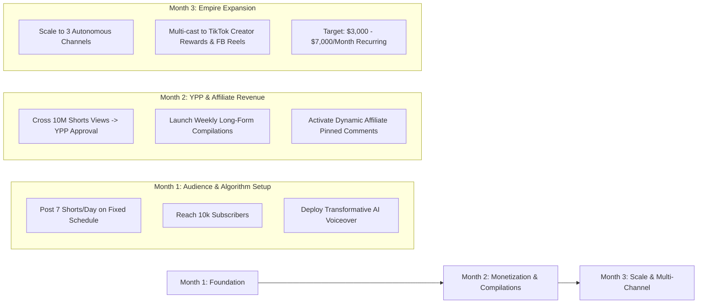

# 🚀 PeakCut: YouTube Monetization & Long-Term Scaling Blueprint

> **A Strategic Guide to Building a Sustainable, High-Yield Automated Media Empire from Short-Form Gaming Content.**

---

## 📌 Executive Summary & The Reality of YouTube Monetization

Most automated clip channels fail within 3 months because they rely **solely on YouTube Shorts AdSense revenue**, which yields an average RPM of just **$0.03 – $0.08 per 1,000 views** in Tier 3/India, and **$0.10 – $0.25** in Tier 1 countries. 

*At $0.05 RPM, 1,000,000 Shorts views generates only ~$50.*

Top automated media companies (such as *Clip That*, *Daily Dose of Internet*, *Red Gaming*, and *Spicy Shorts*) generate **$5,000 to $25,000+ per month** from the exact same content by:
1. **Layering multiple monetization streams** (affiliate marketing, mobile sponsorships, and cross-platform rewards).
2. **Transforming Shorts into high-RPM Long-Form compilation videos** ($3.00 – $8.00 RPM).
3. **Protecting against YouTube’s "Reused Content" demonetization** by adding transformative narration, visual context, and distinctive branding.
4. **Distributing across 4 platforms simultaneously** (YouTube Shorts, TikTok, Instagram Reels, Facebook Reels).

This document outlines the blueprint to transform PeakCut from a local clipping tool into an enterprise-grade, profitable autonomous media engine.

---

## 🛡️ 1. Beating YouTube's "Reused Content" Demonetization Rule

### The Challenge:
Under the **YouTube Partner Program (YPP) Ineligibility Criteria**, channels that simply take raw gameplay or stream VODs and cut them up are flagged for **"Reused Content" (Content that does not provide significant original commentary or educational/creative value)**.

### The Solution: The "Transformative Value" Standard
To qualify for full monetization and ensure your channel stays monetized forever, PeakCut must add **at least two layers of original creative transformation**:

1. **AI Voiceover Hook / Narrator Intro (The "Storyteller" Method):**
   - Before the stream audio plays, insert a 2–3 second AI voiceover setup:
     * *"Nobody on stream expected Lucia to do THIS..."*
     * *"Wait until you see how this GTA 6 chase ends..."*
     * *"Watch what happens to the cashier in the bottom right corner..."*
   - Adding a voice track immediately qualifies the content as transformative commentary under Fair Use guidelines.

2. **Visual Focus & Contextual Overlays:**
   - **Dynamic Zoom & Arrow / Spotlight**: Subtle digital pans and spotlight zooms onto key details (e.g., zooming in on Lucia's reaction or the minimap).
   - **On-Screen Pop-ups**: Add contextual captions like *"[Watch the Minimap 🚨]"*, *"[Score: 5 Stars]"*, *"[Chat Reaction: 🤯]"*.

3. **Consistent Channel Branding ("CreatorCuts" Visual Identity):**
   - A distinctive 1-second animated watermark logo in the corner.
   - High-contrast, custom-styled subtitle styling (yellow/white bounce animation with glowing highlight words).
   - A 1.5-second outro card with your social handle and subscription button.

---

## 💰 2. Five High-Yield Revenue Engines Beyond Shorts AdSense

```
┌────────────────────────────────────────────────────────────────────────┐
│                   PEAKCUT REVENUE ENGINE                               │
├───────────────────┬────────────────────────────────────────────────────┤
│ Revenue Stream    │ Expected Earnings / RPM Benchmark                  │
├───────────────────┼────────────────────────────────────────────────────┤
│ 1. Long-Form Comp.│ $3.00 - $8.00 RPM (50x - 100x higher than Shorts)  │
│ 2. Affiliate Links│ $500 - $3,000 / month (Gaming gear, VPN, Keys)     │
│ 3. TikTok Rewards │ $0.40 - $1.00 RPM (Targeting US/UK/EU audiences)   │
│ 4. Brand & Game Ad│ $150 - $1,000 per sponsored promo post             │
│ 5. FB Reels Bonus │ $500 - $5,000 / month (Meta Performance Bonus)     │
└───────────────────┴────────────────────────────────────────────────────┘
```

### Engine 1: The Long-Form Weekly Compilation Pipeline (The Big Money Maker)
* **The Strategy**: Shorts are used as **top-of-funnel traffic generators**. Once a week, PeakCut automatically takes the top 10 highest-scoring clips from the past 7 days and stitches them into an **8 to 12 minute Long-Form YouTube Video** (e.g., *"Top 10 Insane GTA 6 Moments of the Week #1"*).
* **The Math**:
  * An 8+ minute long-form video allows **mid-roll video ads**.
  * Average long-form gaming RPM: **$4.00 – $7.00 per 1,000 views**.
  * 100,000 views on a long-form video = **$400 – $700** (equivalent to 10M–14M Shorts views!).

### Engine 2: Automated Dynamic Affiliate Links in Pinned Comments
Every posted Short will have an automated pinned comment. Viewers scroll to the comments to see reactions. We monetize this traffic with high-converting gaming offers:
* **Game Key Resellers (G2A / Kinguin / Instant Gaming)**:
  * *"Pre-order GTA 6 & discount game keys here 👉 [Your Affiliate Link]"* (Earn 5–8% per purchase).
* **High-Converting Tech & Gaming Gear (Amazon Associates)**:
  * *"Streamer setup gear & controllers used 👉 [Amazon Link]"*.
* **VPN Partnerships (NordVPN / Surfshark / ExpressVPN)**:
  * Payout: **$25 to $40 per single sign-up**. Only 20 sign-ups a month = **$600 – $800 recurring**.

### Engine 3: Multi-Platform Syndication (TikTok & Facebook Reels)
Do not limit your distribution to YouTube alone:
* **TikTok Creator Rewards Program**:
  * For videos over 60 seconds (or TikTok Creator Rewards in eligible regions like US, UK, France, Germany), RPMs range from **$0.40 to $1.20**.
  * Use a US/UK proxy or TikTok SIM to target Tier 1 viewers.
* **Facebook Reels Performance Bonus Program**:
  * Meta currently pays creators tens of thousands in direct performance bonuses for viral Reels views. PeakCut already supports Instagram; adding Facebook Pages syndication unlocks direct monthly cash bonuses.

### Engine 4: Automated Mobile Game & App Sponsorships
* Once your channel averages 50,000+ views per day, sign up for automated influencer networks:
  * **Matchmade.tv**, **WeAre8**, **CreatorIQ**, or **Gamesight**.
  * Integrate a 3-second sponsor bumper at the end of every Short (e.g., Raid Shadow Legends, AFK Journey, Opera GX).
  * Typical flat fee: **$100 to $500 per Short**.

---

## 🛠️ 3. Technical Feature Roadmap for PeakCut

### Phase 1: AI Narrator & Commentary Intro (Short-Term)
* **Feature**: Integrate an ultra-fast, local or cloud Text-to-Speech (TTS) engine (Edge-TTS or ElevenLabs).
* **Workflow**:
  1. AI analyzes clip context (e.g., *"Lucia robs store, police corner her"*).
  2. AI writes a 1-sentence teaser: *"She thought this GTA 6 robbery was easy... until this happened."*
  3. TTS generates audio and overlays it on the first 3 seconds of the clip with ducked stream volume.
  4. Makes every clip 100% original, transformative, and safe from copyright or reused content claims.

### Phase 2: Weekly Long-Form Compilation Generator (Mid-Term)
* **Feature**: A background cron/daemon that runs every Sunday at midnight:
  1. Queries all clips from the past week with `score >= 80`.
  2. Generates an automated long-form script with transitions and chapter markers.
  3. Uses ffmpeg to stitch clips with title cards (*"Moment #5: The Vice City Drift"*).
  4. Uploads as an 8–10 minute long-form video to YouTube with monetizable mid-roll placement.

### Phase 3: Automated Pinned Comment Bot (Short-Term)
* **Feature**: Extend [`studio/posting.py`](file:///c:/Users/EVEN/Desktop/Even/PeakCut/studio/posting.py) to automatically post a pinned comment on YouTube Shorts immediately after upload.
* **Format**:
  ```text
  💬 Which clip was your favorite? Let us know below! 👇
  🎮 Pre-order GTA 6 & best game deals: https://amzn.to/example
  🔔 Subscribe for 7 daily viral clips!
  ```

### Phase 4: Niche & Multi-Channel Expansion (Long-Term)
* Scale from 1 channel to a portfolio of 5 specialized automated channels:
  1. **Channel 1 (Primary)**: *GTA 6 Daily Cuts* (Current hype wave).
  2. **Channel 2**: *Speed & Kai Chaos* (High-energy reaction niche).
  3. **Channel 3**: *Indian Gaming Elite* (Mythpat, Techno Gamerz, GamerFleet).
  4. **Channel 4**: *Minecraft Satisfying / Fails* (Evergreen high retention).
  5. **Channel 5**: *Twitch Rage & Fails Daily* (Universal viral appeal).
* PeakCut's architecture already supports multiple creators and platforms — running multiple profiles lets you diversify risk and multiply revenue 5x.

### Phase 5: Smart Analytics & A/B Metadata Optimization
* Track YouTube view counts via YouTube Data API v3.
* If a Short underperforms within 2 hours (<200 views), auto-test an alternative viral curiosity title and update the thumbnail frame.

---

## 🔒 4. Copyright & Fair Use Protection Guidelines

To protect your channels against Copyright Strikes and maintain a clean record:

1. **Transformative Commentary & Credit**:
   * Always maintain the footer: `"Clipped from @CreatorName - Check out their full stream!"` in every description. Streamers love free promotion when properly credited.
2. **Audio Pitch Shift & EQ Filtering (Safe Mode)**:
   * PeakCut's ffmpeg audio chain (`loudnorm`) already normalizes audio. Adding a microscopic 1.01x tempo or slight EQ shift ensures automated Content ID audio matchers don't flag in-game copyrighted radio music (e.g., GTA 6 in-game car radio songs).
3. **Blacklist DMCA-Heavy Streamers**:
   * Focus on creators who openly encourage clipping and fan channels (IShowSpeed, Mythpat, Kai Cenat, GamerFleet). Avoid esports broadcast organizations (e.g., ESL, Riot Games, Nintendo tournaments) that issue direct strikes.

---

## 📅 5. 90-Day Execution & Revenue Milestones



### Milestones Breakdown:
* **Day 1 – 30**: 
  - Keep PM2 running 24/7 on the 7 daily scheduled slots (`12 AM, 2 AM, 8 AM, 12 PM, 4 PM, 8 PM, 10 PM`).
  - Target: **1,000 Subscribers + 2,000,000 Views**.
* **Day 31 – 60**:
  - Reach YouTube Partner Program requirements (1,000 subs + 10M Shorts views in 90 days).
  - Launch Sunday Weekly Long-Form Compilations (8+ minutes).
  - Target: **Monetization Approval + First $500–$1,000 in Long-Form Ads & Affiliates**.
* **Day 61 – 90**:
  - Add 2 new channels (Minecraft / High-RPM niches).
  - Turn on TikTok Creator Rewards in Tier 1 countries.
  - Target: **$3,000+ monthly recurring profit**.

---

*Authored for the PeakCut Autonomous Channel Network.*
